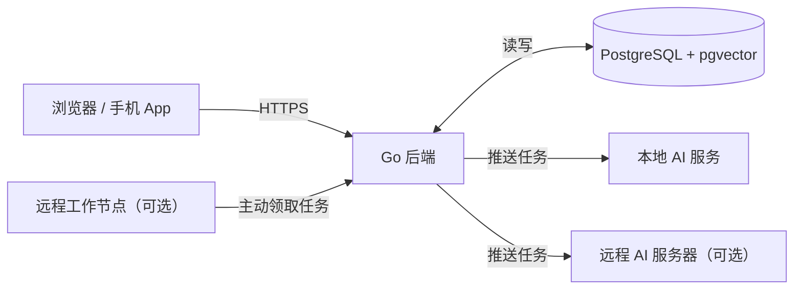

# Wanmory 万象

Wanmory 万象是一个运行在家庭服务器上的 AI 家庭媒体中心，管理照片、视频、音乐和电影，并用 AI 做人脸识别、语义搜索和回忆生成。所有 AI 能力都由一个独立的 AI 服务提供，模型可以更换，AI 服务可以部署在本机，也可以部署在用户指定的远程服务器上。

设计原则：

- **本地优先**：照片和数据默认只存在用户自己的设备上，不依赖任何云服务
- **开箱即用**：默认配置就是原型阶段实测效果最好的模型组合，用户不需要做任何选择
- **模型可替换**：每一类 AI 任务都可以单独换模型，按硬件选择高精度、均衡或轻量档位
- **算力可远程**：NAS 算力不够时，可以把 AI 任务交给家里的 Mac、带显卡的电脑或自建服务器

## 系统架构

部署时是 3 个容器：Go 后端、Python AI 服务、PostgreSQL；远程 AI 服务器和工作节点是可选的。



浏览器和手机只连 Go 后端；后端把推理任务推给本地或远程 AI 服务，工作节点也可以主动领取任务，所有结果只写进 PostgreSQL。

| 组件 | 技术 |
| --- | --- |
| 后端 | Go；libvips 生成缩略图，FFmpeg 转码，ExifTool 读元数据 |
| AI 服务 | Python + FastAPI + ONNX Runtime（另有 PyTorch 用于 CLIP） |
| 前端 | React + TypeScript + Vite，打包成静态文件 |
| 数据库 | PostgreSQL + pgvector，任务队列用表实现，不需要 Redis |
| 部署 | Docker Compose；开发用 Mac + OrbStack，生产用家里的 NAS。Mac 上的 AI 服务在本机直接运行，不放进容器（容器在 macOS 上用不到 Apple GPU） |

## AI 能力与默认模型

默认模型就是原型阶段实测效果最好的组合；每项任务都可以在配置里单独替换。

| 任务 ID | 功能 | 默认模型 | 可选替代 | 状态 |
| --- | --- | --- | --- | --- |
| `face.detect` | 人脸检测 | SCRFD-10G（InsightFace antelopev2） | SCRFD-2.5G（弱 CPU） | 已实测 |
| `face.embed` | 人脸特征 | ArcFace R100（glintr100） | AdaFace IR101、ArcFace R50（buffalo_l） | 已实测 |
| `face.age` | 年龄估计 | InsightFace genderage | — | 已实测 |
| `clip` | 语义搜索 | Chinese-CLIP ViT-H/14 | Chinese-CLIP ViT-L/14、ViT-B/16 | 已实测 |
| `ocr` | 文字识别 | Mac：Apple Vision；其他：PP-OCRv6 medium | PP-OCRv6 small / tiny | 已实测 |
| `caption` | 照片描述 | Qwen3-VL 8B（Ollama） | 更小的 Qwen3-VL，或关闭 | 可选，流程已测 |
| `text.embed` | 描述的文字匹配 | BGE-large-zh-v1.5 | BGE-base-zh | 流程已测 |
| `asr` | 语音转文字、字幕 | Whisper | — | 计划 |
| `audio.embed` | 音乐心情和风格 | CLAP | — | 计划 |
| `depth` | MV 的 2.5D 视差 | Depth Anything V2 | — | 计划 |
| `img2video` | 照片变视频 | Wan 2.2 / LTX-2.3 | — | 计划，需要显卡 |

除模型外，人脸分组、质量过滤、人物原型、小孩更严格的阈值、合并建议和搜索截断由后端算法完成，不占用 AI 服务。

## 模型配置

所有 AI 配置都在网页的「设置 → AI」页面操作，存在数据库里，修改后立即生效，用户不需要改任何文件。只有启动必需的几项（数据库密码、端口、照片存放路径）写在 Docker Compose 的环境变量里。页面上先选一个档位，高级用户再按任务单独换模型。

| 档位 | 适合的硬件 | 人脸 | 语义搜索 | 文字识别 | 照片描述 |
| --- | --- | --- | --- | --- | --- |
| `quality`（默认） | Apple 芯片 Mac、NVIDIA 显卡 | SCRFD-10G + ArcFace R100 | Chinese-CLIP ViT-H/14 | Vision / PP-OCRv6 medium | Qwen3-VL 8B（可选） |
| `balanced` | Intel i5 级别的 NAS | SCRFD-10G + ArcFace R100 | Chinese-CLIP ViT-L/14 | PP-OCRv6 medium | 关闭，或交给远程服务器 |
| `lite` | N100、树莓派 5 | SCRFD-2.5G + ArcFace R50 | Chinese-CLIP ViT-B/16 | PP-OCRv6 small | 关闭 |

「设置 → AI」页面上的选项：

| 设置项 | 页面上的控件 | 默认值 |
| --- | --- | --- |
| 档位 | 三选一卡片，写明适合的硬件 | 根据 AI 服务检测到的硬件自动推荐 |
| 各任务的模型 | 每个任务一个下拉框，列出可用模型、大小和许可 | 跟随档位 |
| 任务开关 | 每个任务一个开关（文字识别、照片描述等） | 照片描述关闭，其他打开 |
| 人脸分组严格程度 | 一个滑块：更容易合并 ↔ 更不容易认错 | 原型实测值（0.38） |
| 恢复默认 | 一个按钮 | — |

数据库里用一张键值表保存，值是 JSON，以后加新选项不用改表结构：

```sql
CREATE TABLE settings (
  key        TEXT PRIMARY KEY,      -- 例如 'ai.preset'、'ai.models'、'ai.tasks'
  value      JSONB NOT NULL,        -- 例如 '"quality"'、'{"face.embed": "adaface-ir101"}'
  updated_at TIMESTAMPTZ NOT NULL DEFAULT now(),
  updated_by UUID                   -- 哪个管理员改的
);
```

只有管理员能改 AI 设置；每次修改都记录修改人和时间，方便出问题时恢复。

规则：

- **换模型只重算受影响的部分**：每条向量都记录生成它的模型 ID，换了 `clip` 只重算语义向量，人脸和文字不动
- **换人脸模型会保留人名**：已确认的人脸用新模型重新算特征，再用它们重建人物原型，不需要重新起名
- **新旧模型不混用**：重算完成前，搜索继续用旧向量，全部完成后一次性切换
- **模型自动下载**：第一次用到时下载到 AI 服务的缓存目录，支持断点续传

## AI 服务器

后端可以连接一个或多个 AI 服务器，地址由用户自定义；默认只有一个，就是和后端一起启动的本地容器。

服务器在「设置 → AI 服务器」页面添加，存在数据库的 `ai_servers` 表里。每台服务器填这几项：

| 字段 | 说明 | 例子 |
| --- | --- | --- |
| 名称 | 方便辨认 | 书房的 Mac |
| 地址 | AI 服务的 URL | http://192.168.1.20:3003 |
| 令牌 | 远程服务器必填，加密保存，页面上只显示后四位 | •••• 3f9a |
| 接哪些任务 | 多选；不选表示接所有任务 | 照片描述、语义搜索 |
| 优先级 | 数字越大越优先 | 10 |

添加时页面先请求这台服务器的 `/health` 和 `/models`，显示它的硬件加速和已有模型，连不上就不让保存。列表里每台服务器实时显示在线状态和正在处理的任务数。本地 AI 服务是默认内置的一项，不能删除，也是远程不可用时的回退。

路由规则：

1. 每个任务在接这项任务、且健康检查通过的服务器里，选优先级最高的一台
2. “接哪些任务”一项都不选的服务器可以接所有任务
3. 后端每 30 秒请求一次 `/health`，连续失败就暂时不分配任务，恢复后自动重新加入
4. 全部不可用时，任务留在队列里等待，不会丢失
5. 一个任务里的所有向量必须来自同一个模型：服务器在 `/models` 里报告自己加载的模型，和配置不一致的服务器不会收到该任务

常见部署方式：

| 场景 | 做法 |
| --- | --- |
| 只有一台 NAS | 只用默认的 `local`，选 `balanced` 或 `lite` 档位 |
| NAS + 家里的 Mac | Mac 上直接运行 AI 服务（`uv run`，不用容器），或者作为远程工作节点，把照片描述、语义向量交给它。Docker/OrbStack 容器在 macOS 上用不到 Apple GPU，CoreML、MPS 和 Apple Vision 都没有，只能跑 CPU |
| NAS + 带显卡的电脑 | 显卡机器跑 CUDA 版镜像，负责照片变视频、字幕等重任务 |
| 外面的服务器 | 只通过 Tailscale 或 HTTPS 连接，必须设置 `token` |

## 远程计算与训练

远程计算有两种方式：后端主动推送（上一节），或者远程工作节点主动领取任务。训练分两个层次：默认的个性化学习不需要显卡，模型微调是可选的高级功能。

### 远程工作节点

适合不一直开机的电脑，比如 Mac 或游戏本：开机时帮忙算，关机了 NAS 自己慢慢算。

1. 用户在设置页生成一个工作节点令牌
2. 在远程电脑上运行 `wanmory-ml worker --server https://家里的地址 --token ...`
3. 节点向后端领取它支持的任务，下载预览图，算完把结果传回
4. 每个领取的任务有租期（默认 10 分钟），节点掉线后任务自动退回队列

节点只拿到 1440 像素的预览图，拿不到原图和数据库。

### 个性化学习（默认开启，不需要显卡）

- **人物原型**：用户起名、确认、移出的人脸都会更新每个人的“标准长相”，新照片按它自动归类
- **个人阈值**：根据用户确认和拒绝的合并建议，微调这个家庭自己的分组阈值
- **宝宝成长**：按年龄段分别保存原型，跟上孩子长相的变化

### 模型微调（可选，需要显卡）

- 用已确认的人脸和照片描述，在远程显卡节点上训练一个小的适配层（不动原始模型）
- 训练完成后，适配层作为一个新的模型版本登记，用户在设置页手动启用；启用后按“换模型”的规则重算
- 训练数据和结果不离开用户自己的设备

## AI 服务接口约定

AI 服务是无状态的 HTTP 服务，只接收图片、音频或文字并返回结果，不访问数据库。只要实现这几个接口，第三方也可以写自己的 AI 服务替换掉官方的。

| 接口 | 作用 |
| --- | --- |
| `GET /health` | 健康检查，返回版本和可用的硬件加速（CPU、CUDA、CoreML、OpenVINO） |
| `GET /models` | 已支持和已加载的模型：任务 ID、模型 ID、向量维度 |
| `POST /models/load` | 预加载或切换某个任务的模型 |
| `POST /predict` | 推理：一次请求可以做多项任务 |

`/predict` 的请求用 multipart，文件在 `image` 字段，任务在 `tasks` 字段：

```json
{
  "face":    {"model": "antelopev2", "min_score": 0.5},
  "clip":    {"model": "chinese-clip-vit-h-14"},
  "ocr":     {}
}
```

返回：

```json
{
  "face": [{"box": [x, y, w, h], "score": 0.93, "landmarks": [[x, y], ...],
            "embedding": [512 个数], "yaw": 0.12, "blur": 340}],
  "clip": {"embedding": [1024 个数]},
  "ocr":  {"text": "居民身份证 ...", "lines": [{"text": "...", "score": 0.98}]},
  "model_ids": {"face": "antelopev2", "clip": "chinese-clip-vit-h-14", "ocr": "pp-ocrv6-small"}
}
```

搜索词也走 `/predict`：`tasks` 传 `{"clip.text": {"text": "海边日落"}}`，返回文字向量。返回里的 `model_ids` 由后端核对，和配置不一致的结果会被丢弃并重新排队。

## 隐私、安全与模型许可

默认配置下，照片和所有 AI 结果都不离开家庭网络；打开远程 AI 服务器时，设置页要明确告诉用户哪些任务会把预览图发出去。

- **鉴权**：本地 AI 容器只在 Docker 内部网络暴露；任何远程服务器和工作节点都必须带令牌，令牌可以随时在设置页吊销
- **传输**：离开本机的连接只允许 HTTPS 或 Tailscale
- **最少数据**：AI 服务只拿到预览图，不保存任何文件，不接触数据库、人名和原图
- **敏感内容**：识别出的证件文字只存在本地数据库，可以在设置里关闭对证件类照片的文字识别

| 组件 | 许可限制 |
| --- | --- |
| InsightFace 人脸模型（SCRFD、ArcFace、genderage） | 仅限非商业用途；商业化前需要替换或购买授权 |
| Immich 源码 | AGPL-3.0；参考设计思路，不直接复制代码 |
| OpenStreetMap 官方底图、Nominatim 地名查询 | 只适合少量个人使用（Nominatim 每秒最多 1 次，网页里排队、查过的存在浏览器里）；产品化换成商业地图服务或自建 |
| Natural Earth 世界轮廓（`world-atlas` 包） | 公有领域；没开在线地图时足迹用它画简笔地图 |
| EOX Sentinel-2 cloudless 2016 卫星图 | CC BY 4.0，需要署名（地图右下角已写）；更新年份的版本是非商业许可 |
| MapLibre GL（卫星地球） | BSD-3-Clause |

模型文件不放进代码仓库和 Docker 镜像，由用户第一次使用时自动下载，下载前在设置页展示每个模型的许可。

## 目录结构

| 目录 | 说明 |
| --- | --- |
| `server/` | Go 后端：API、任务队列、数据库 |
| `ml/` | Python AI 服务：人脸、CLIP、OCR |
| `web/` | React 前端 |
| `docker/` | 部署与开发用的 docker-compose |
| `docs/` | 文档 |

## 开发

需要本机装好 Go、Node、ExifTool、libvips、FFmpeg（`brew install exiftool vips ffmpeg`）。

```bash
docker compose -f docker/docker-compose.dev.yml up -d postgres   # 启动开发数据库
make web       # 打包前端，复制到 server/internal/webui/dist
make run       # 后端 + 网页都在 http://localhost:8080，启动时自动执行数据库迁移
```

前端页面嵌在 Go 程序里，由后端直接提供，部署时不需要 Node。平时开发用 `make live`：一条命令启动数据库（已经在跑就跳过）、后端、AI 服务和前端开发服务器（第一次还会下载约 48 MB 的 IP 地址库到 `data/ipdb`，登录日志按 IP 显示大概位置用，数据来自 [ip2region](https://github.com/lionsoul2014/ip2region)，Apache-2.0；Docker 镜像里自带），打开 http://localhost:5173，改完页面马上更新，`/api` 转发给 8080 的后端；每行输出前面标着来自哪个（`[server]` `[ai]` `[web]`），Ctrl+C 全部一起停（也可以分开跑 `make run`、`make ml-run`、`make web-dev`）；提交前端代码前在 `web/` 里跑 `npm run typecheck` 和 `npm run format`（Prettier，顺带给 Tailwind 类名排序）；改完再 `make web` 并重启后端，8080 上才会是新页面。

上传的照片和生成的缩略图放在项目下的 `data/`（已加入 .gitignore）。

人脸识别、智能搜索和自动分类要另外运行 AI 服务：`make ml-run`（在本机跑，Mac 上人脸用 CoreML、CLIP 用 MPS 加速；第一次会下载约 340 MB 的人脸模型和约 3.8 GB 的 Chinese-CLIP ViT-H/14 到 `~/.cache/wanmory/models`，CLIP 在后台下载、加载，期间人脸识别照常工作，搜索会提示稍后再试）。有显卡（Mac 的 MPS、NVIDIA 的 CUDA）时 CLIP 用半精度运行，占约 1.9 GB 内存；只有 CPU 时用全精度，约 4 GB。用 `WANMORY_CLIP_MODEL` 换成小一些的 `chinese-clip-vit-l-14`、`chinese-clip-vit-b-16`（后端和 AI 服务要设成一样的）。后端默认连 `http://127.0.0.1:3003`，用 `WANMORY_ML_URL` 改成别的地址；AI 服务设置了 `WANMORY_ML_TOKEN` 时后端也要设置同样的值。图片是随请求用 HTTP 发过去的，AI 服务放在哪台机器上都行。AI 服务没启动时人脸任务留在队列里，启动后自动接着做；已有的照片在后端启动时自动补排。

不想在本机装这些工具，可以用 `make run-docker` 在容器里跑后端（和 `make run` 二选一，都占 8080 端口），本机只需要 Docker。

## 挂载已有的照片目录

NAS、移动硬盘、电脑上已经有很多照片，不用一张张上传：把目录挂载进相册的照片目录（Docker 里是 `/photos`，本机开发是 `data/library`），相册每 15 分钟扫一遍，新的照片和视频**原地导入**（不复制、不移动），然后和上传的一样读拍摄信息、生成缩略图、做 AI 识别（人脸、分类、语义搜索、文字识别）。

在 `docker-compose.yml` 的 `server` 下面加几行，每个目录挂到 `/photos` 下面的一个子目录：

```yaml
    volumes:
      - ./data:/data
      - /mnt/nas/photos:/photos/nas:ro        # 结尾 :ro 是只读
      - /media/usb/相机照片:/photos/usb:ro
      - /home/me/Pictures:/photos/pictures     # 不加 :ro 是可读写
```

改完运行 `docker compose up -d`，最多等 15 分钟（重启后 20 秒左右扫第一遍）就会出现在图库里。

- **可以挂多个目录**，以后再挂新的目录也一样，扫到就自动导入、自动 AI 处理。
- **只读挂载（`:ro`）更安全**：相册不会往这些目录里写任何东西；在相册里删除照片只是放进「最近删除」，永久删除时原文件也留着，只是相册里不再显示，以后也不会再被扫进来。可读写挂载的目录，永久删除会连原文件一起删掉。
- 内容完全一样的照片只算一张（已经上传过的、两个目录里重复的都只保留一份）。
- 不扫隐藏目录和 NAS 自己的缩略图、回收站（`.xxx`、`@eaDir`、`#recycle` 等）。
- 从照片目录导入的照片不属于哪个成员，只有管理员能删除。

## 访问域名

在「系统设置 → 访问域名」里改，默认 `wanmory.local`，必须以 `.local` 结尾。相册自己在局域网里报这个名字（mDNS，Docker 里是 `docker-compose.yml` 的 `mdns` 服务），Mac、iPhone、iPad、Windows 10 以后不用设置路由器就能打开 `http://wanmory.local:8080`；部分安卓手机不支持，用 IP 打开。

## 部署注意

网页上传用的是 [tus](https://tus.io) 分片上传（`/api/uploads/`），每片 16 MB，断网或刷新页面后可以接着传。放在反向代理后面时，要允许单个请求至少 16 MB，例如 Nginx 默认只有 1 MB：

```nginx
location /api/uploads/ {
    proxy_pass http://wanmory:8080;
    client_max_body_size 0;          # 不限制请求大小（或至少 20m）
    proxy_request_buffering off;     # 边收边转发，不先存到代理的磁盘上
    proxy_set_header Host $host;
    proxy_set_header X-Forwarded-Proto $scheme;
}
```

Cloudflare 免费版单个请求上限 100 MB，不用改。

## 忘记密码

成员忘了密码：管理员在「系统设置 → 成员」里点他名字旁边的「重置密码」。

管理员自己忘了密码，或者连名字也忘了：在运行相册的机器上（例如树莓派），进到放 `docker-compose.yml` 的目录，运行

```bash
docker compose exec server wanmory reset-password
```

它会列出这台相册上的所有账号（名字、是不是管理员、创建时间、最近一次登录），输入序号选一个，再输两遍新密码（输入时不显示）：

```
这台相册上的账号：
  1. 王东杰       管理员   2026-11-03 创建   最近登录 2026-11-08
  2. liao                  2026-11-03 创建   最近没有登录
重置哪一个的密码？输入序号（直接回车退出）：1
新密码：
再输一遍：
已重置「王东杰」的密码，请用新密码登录（所有设备上的登录都已退出）。
```

- 记得名字时可以直接带上，跳过列表：`docker compose exec server wanmory reset-password 王东杰`
- 只想看看有哪些账号，到问序号时直接回车退出，什么都不改
- 改好后这个人在所有设备上的登录都会退出，要用新密码重新登录；照片、相册都不受影响
- 只有能登录这台机器、操作 Docker 的人才能运行，网页上没有这个入口
- 不用 Docker、直接运行程序的，把命令换成 `wanmory reset-password`（要带着平时运行时的 `DATABASE_URL` 等环境变量）

## 许可证

[AGPL-3.0](LICENSE)
