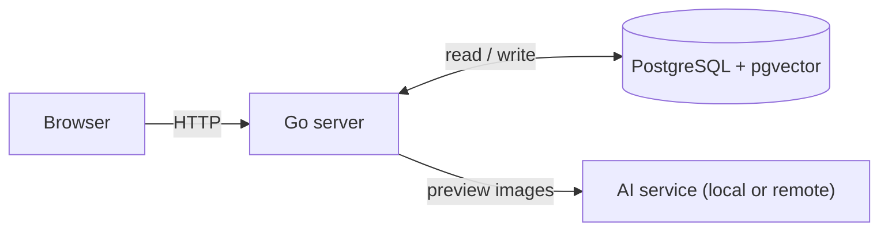

# Wanmory

**English** | [简体中文](README.zh-CN.md)

Wanmory is an open-source, self-hosted AI photo library. Run it with Docker on a NAS, a Raspberry Pi or any home server, and keep every photo, thumbnail and AI result on your own hardware — no cloud, no subscription.

[Website](https://wanmory.com) · [Documentation](https://wanmory.com/docs/) · [Live demo](https://demo.wanmory.com) · [Releases](https://github.com/i-dj/wanmory/releases)


## Features

- **Face recognition** — faces are grouped into people automatically; name them once, and see how someone has grown over the years
- **Natural-language search** — describe a photo ("sunset at the beach") and find it, powered by Chinese-CLIP; text in photos is searchable too (OCR)
- **Smart organization** — timeline, categories (scenery, food, animals…), On This Day memories, a footprint map, burst and duplicate cleanup
- **Albums and sharing** — regular and smart albums, multiple accounts with their own uploads, private albums, guest browsing
- **Fast, resumable uploads** — drag in photos, videos or whole folders; large files upload in chunks and resume after interruptions; duplicates are skipped by content
- **Import in place** — mount existing photo folders (read-only if you like); new photos are picked up every 15 minutes, originals are never moved
- **Local AI that scales** — runs on CPU out of the box (amd64 and arm64), or hand the AI work to a Mac or GPU machine on your network
- **12 languages** — the interface follows your browser language

## Quick start

You need a 64-bit Linux or macOS machine with [Docker](https://docs.docker.com/engine/install/) and Docker Compose, at least 2 GB of RAM (4 GB or more recommended for AI).

### One-line installer

```bash
curl -fsSL https://wanmory.com/install.sh | bash
```

Press Enter to accept the defaults. The script checks your system, asks a few questions (port, data folders, existing photo folders), writes the configuration, starts everything and prints the address to open. Add `-y` to skip the questions.

### Or with Docker Compose

```bash
mkdir -p ~/wanmory && cd ~/wanmory
curl -fsSLO https://raw.githubusercontent.com/i-dj/wanmory/main/docker/docker-compose.yml
echo "WANMORY_DB_PASSWORD=$(openssl rand -hex 16)" > .env
docker compose up -d
```

Then:

1. Open `http://<your-server-ip>:8080` (or `http://wanmory.local:8080` on most devices) and create the admin account.
2. Go to **Settings → How AI runs** and download the models for your tier. Face recognition and search start once the models are in place.
3. Upload photos, or [mount the folders you already have](#import-existing-photos).

## Update

```bash
cd ~/wanmory
docker compose pull && docker compose up -d
```

Photos, the database, settings and models are kept; database migrations run automatically on startup. **Settings → System update** shows when a new version is available, with release notes. If you pinned a version with `WANMORY_VERSION` in `.env`, change it first.

## Uninstall

```bash
curl -fsSL https://wanmory.com/uninstall.sh | bash
```

Containers and networks are always removed. The database, data folder, AI models, images and config files are each asked about and kept by default; deleting the database or data folder requires typing `DELETE`. Mounted photo folders are never touched. `-y` removes only the containers, `--purge` removes everything without asking, `--dry-run` shows what would happen.

## Configuration

Set these in a `.env` file next to `docker-compose.yml` (all optional):

| Variable | Default | Purpose |
| --- | --- | --- |
| `WANMORY_PORT` | `8080` | Web port |
| `WANMORY_DOMAIN` | `wanmory.local` | LAN domain announced over mDNS; must end in `.local` |
| `WANMORY_DB_PASSWORD` | `wanmory` | Database password; set it once, it can't be changed after the first start |
| `WANMORY_TZ` | `Asia/Shanghai` | Time zone for photos whose EXIF has none |
| `WANMORY_DATA_DIR` | `./data` | Uploaded originals, thumbnails and previews |
| `WANMORY_MODELS_DIR` | `./models` | AI models (1–4 GB) |
| `WANMORY_DB_DIR` | `pgdata` volume | Database folder; use a local disk, not a network share |
| `WANMORY_VERSION` | `latest` | Image tag |
| `WANMORY_REGISTRY` | `ghcr.io/i-dj` | Image registry; switch to a mirror if pulls are slow |

## Import existing photos

Mount each folder under `/photos` in the `server` service of `docker-compose.yml`:

```yaml
    volumes:
      - ./data:/data
      - /mnt/nas/photos:/photos/nas:ro        # :ro = read-only
      - /media/usb/camera:/photos/usb:ro
      - /home/me/Pictures:/photos/pictures     # read-write
```

Run `docker compose up -d`. Wanmory scans every 15 minutes (the first scan runs about 20 seconds after startup) and imports new photos and videos **in place** — nothing is copied or moved — then reads their metadata, generates thumbnails and runs AI on them like any upload.

- Mount as many folders as you like, now or later.
- Read-only mounts are safest: Wanmory never writes to them. Deleting a photo moves it to Recently deleted; deleting it permanently hides it but leaves the original file. In read-write folders, permanent deletion also deletes the file.
- Identical files are stored once, even if they appear in several folders.
- Hidden folders and NAS system folders (`.xxx`, `@eaDir`, `#recycle`…) are skipped.

## AI

All AI runs in a separate, stateless service (`ml/`). Pick a tier in **Settings → How AI runs → Model tier**; models are downloaded on demand, nothing is bundled in the images.

| Tier | Good for | Faces | Semantic search |
| --- | --- | --- | --- |
| High accuracy (`quality`) | Apple silicon Mac, NVIDIA GPU | InsightFace antelopev2 (SCRFD-10G + ArcFace R100) | Chinese-CLIP ViT-H/14 |
| Balanced (`balanced`) | Intel i5-class NAS, 8 GB+ RAM | antelopev2 | Chinese-CLIP ViT-L/14 |
| Lite (`lite`) | N100, Raspberry Pi 5, 4 GB RAM | InsightFace buffalo_l | Chinese-CLIP ViT-B/16 |

Text recognition uses PP-OCR through RapidOCR on every tier. Switching tiers only reprocesses what the new models affect, and named people are kept.

**When AI runs** — **Settings → Background processing**: *When idle* (default; pauses while photos upload), *Anytime*, or *At night* (a time window you choose). *Wait after uploads* delays AI by 30 seconds to 4 hours after a batch finishes. AI also waits while any upload is still in progress, and pauses until the models of the current tier are downloaded.

### Run the AI service on another machine

On a faster computer (Apple silicon Mac, or Windows / Linux with an NVIDIA GPU), run `ml/` directly with [uv](https://docs.astral.sh/uv/):

```bash
# macOS / Linux
curl -LsSf https://astral.sh/uv/install.sh | sh
git clone https://github.com/i-dj/wanmory.git && cd wanmory/ml
uv sync --extra torch                      # without a GPU, plain `uv sync` (and drop --extra torch below)
export WANMORY_ML_TOKEN=$(openssl rand -hex 24)
WANMORY_FACE_MODEL_PRELOAD=1 uv run --extra torch python -m wanmory_ml
```

```powershell
# Windows (PowerShell)
powershell -ExecutionPolicy ByPass -c "irm https://astral.sh/uv/install.ps1 | iex"
git clone https://github.com/i-dj/wanmory.git; cd wanmory\ml
uv sync --extra torch
uv pip install --reinstall torch --index-url https://download.pytorch.org/whl/cu126   # NVIDIA GPU
$env:WANMORY_ML_TOKEN = [guid]::NewGuid().ToString("N") + [guid]::NewGuid().ToString("N")
uv run --no-sync python -m wanmory_ml
New-NetFirewallRule -DisplayName "Wanmory AI" -Direction Inbound -Protocol TCP -LocalPort 3003 -Action Allow   # as administrator
```

It listens on `0.0.0.0:3003` (`WANMORY_ML_HOST`, `WANMORY_ML_PORT`) and keeps models in `~/.cache/wanmory/models` (`WANMORY_MODEL_DIR`). In Wanmory, open **Settings → How AI runs**, choose **Remote service**, enter the service URL (e.g. `http://192.168.1.20:3003`) and the access token, test the connection and save. Keep port 3003 on your LAN or VPN; don't expose it to the internet. Only preview images (1440 px) are sent to the AI service — never originals or the database.

## Local domain

Wanmory announces `wanmory.local` on your network (mDNS), so Macs, iPhones, iPads and Windows 10+ can open `http://wanmory.local:8080` without any router setup. Change it in **Settings → Local domain**. Some Android phones don't support mDNS; use the IP address there.

## Reverse proxy

Uploads use [tus](https://tus.io) with 16 MB chunks (`/api/uploads/`). Behind a reverse proxy, allow requests of at least 16 MB — Nginx defaults to 1 MB:

```nginx
location /api/uploads/ {
    proxy_pass http://wanmory:8080;
    client_max_body_size 0;          # or at least 20m
    proxy_request_buffering off;
    proxy_set_header Host $host;
    proxy_set_header X-Forwarded-Proto $scheme;
}
```

Cloudflare's free plan allows 100 MB per request, which is enough.

## Forgot your password

Members: an admin resets it in **Settings → Members → Reset password**.

Admins: on the machine running Wanmory, in the folder with `docker-compose.yml`, run

```bash
docker compose exec server wanmory reset-password
```

It lists the accounts, lets you pick one and asks for a new password twice. You can pass the account name directly: `docker compose exec server wanmory reset-password alice`. The account is signed out everywhere; photos and albums are not affected. Only someone with shell access to the machine can do this.

## Architecture

Three containers: a Go server, a Python AI service and PostgreSQL. A remote AI service is optional.



| Part | Stack |
| --- | --- |
| Server | Go; libvips for thumbnails, FFmpeg for video, ExifTool for metadata; the web UI is embedded in the binary |
| AI service | Python, FastAPI, ONNX Runtime (PyTorch optional for CLIP on GPUs) |
| Web | React, TypeScript, Vite, Tailwind CSS |
| Database | PostgreSQL with pgvector; the job queue is a table (`SKIP LOCKED`), no Redis |

The AI service is a stateless HTTP API (`GET /health`, `GET /models`, `POST /predict`); it receives images and returns faces, embeddings and text, and never touches the database.

| Folder | Contents |
| --- | --- |
| `server/` | Go server: API, job queue, database migrations |
| `ml/` | Python AI service: faces, CLIP, OCR |
| `web/` | React web app |
| `website/` | Project website (wanmory.com) |
| `docker/` | Docker Compose files for deployment and development |

## Development

Install Go, Node, ExifTool, libvips and FFmpeg (`brew install exiftool vips ffmpeg` on macOS), plus [uv](https://docs.astral.sh/uv/) for the AI service.

```bash
make live    # database (Docker), Go server, AI service and the Vite dev server together
```

Open http://localhost:5173 — the page reloads as you edit, and `/api` is proxied to the server on 8080. Each output line is prefixed with `[server]`, `[ai]` or `[web]`; Ctrl+C stops everything. You can also run the parts separately with `make run`, `make ml-run` and `make web-dev`.

- `make web` builds the web app into the server binary, so `make run` alone serves everything on http://localhost:8080.
- `make run-docker` runs the server in a container if you'd rather not install the native tools.
- Uploads and thumbnails go to `data/` (git-ignored).
- Before committing web changes, run `npm run typecheck` and `npm run format` in `web/`.

## Third-party licenses

| Component | License |
| --- | --- |
| InsightFace face models (SCRFD, ArcFace) | Non-commercial research use only; replace them or obtain a license for commercial use |
| Chinese-CLIP | MIT |
| PP-OCR (via RapidOCR) | Apache-2.0 |
| OpenStreetMap tiles, Nominatim geocoding | Light personal use only (Nominatim max. 1 request/second, queued and cached in the browser) |
| Natural Earth outlines (`world-atlas`) | Public domain |
| EOX Sentinel-2 cloudless 2016 | CC BY 4.0 (attributed on the map) |
| MapLibre GL | BSD-3-Clause |
| ip2region IP database | Apache-2.0 |

Model files are not included in this repository or the Docker images; they are downloaded on first use.

## License

[AGPL-3.0](LICENSE)
