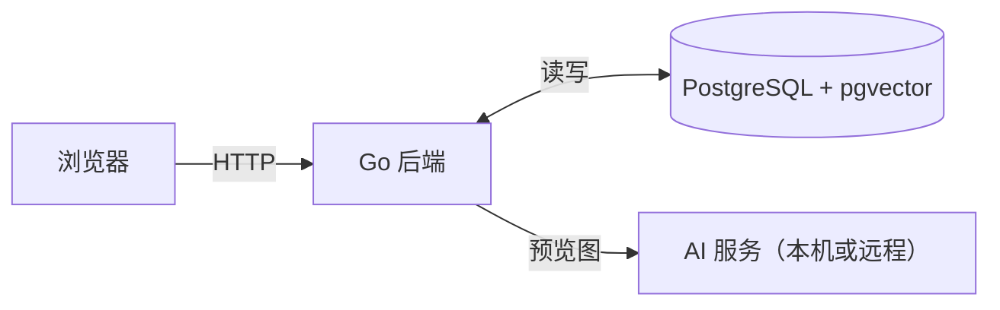

# 万象 Wanmory

[English](README.md) | **简体中文**

万象是一个开源、自托管的 AI 相册。用 Docker 部署到 NAS、树莓派或任何一台自己的服务器上，照片、缩略图和 AI 识别结果都留在自己的设备里：不上云，不订阅。

[官网](https://wanmory.com/zh/) · [部署与文档](https://wanmory.com/zh/docs/) · [在线演示](https://demo.wanmory.com) · [版本发布](https://github.com/i-dj/wanmory/releases)


## 功能

- **人脸识别**：自动把同一个人的照片归到一起，起一次名字就行；还能按年龄看一个人的成长
- **自然语言搜索**：用一句话描述照片（「海边的日落」）就能找到，基于 Chinese-CLIP，中文效果尤其好；照片里的文字也能搜（OCR）
- **自动整理**：时间线、风景 / 美食 / 动物等分类、那年今天、足迹地图、连拍和重复照片整理
- **相册与共享**：普通相册和智能相册，多账号各自上传，私有相册，访客浏览
- **上传又快又稳**：照片、视频、整个文件夹直接拖进来；大文件分片上传，中断后接着传；内容重复的自动跳过
- **原地导入**：挂载已有的照片目录（可以只读），每 15 分钟自动发现新照片，原文件不复制、不移动
- **AI 按需扩展**：默认只用 CPU 就能跑（amd64 和 arm64 都有），也可以把 AI 交给局域网里的 Mac 或显卡电脑来算
- **12 种语言**：界面跟随浏览器语言

## 快速部署

需要一台装好 [Docker](https://docs.docker.com/engine/install/) 和 Docker Compose 的 64 位 Linux 或 macOS，内存至少 2 GB（用 AI 建议 4 GB 以上）。

### 一键安装

```bash
curl -fsSL https://wanmory.com/install.sh | bash
```

一路回车用默认值即可。脚本会检查系统、问几个问题（端口、数据目录、已有的照片目录）、写好配置、启动服务，最后打印访问地址。加 `-y` 不提问，全部用默认值。

### 或者用 Docker Compose

```bash
mkdir -p ~/wanmory && cd ~/wanmory
curl -fsSLO https://raw.githubusercontent.com/i-dj/wanmory/main/docker/docker-compose.yml
echo "WANMORY_DB_PASSWORD=$(openssl rand -hex 16)" > .env
docker compose up -d
```

然后：

1. 打开 `http://服务器IP:8080`（大多数设备也可以用 `http://wanmory.local:8080`），创建管理员账号。
2. 到「系统设置 → AI 运行方式」下载当前档位的模型，下载好后人脸识别和搜索就开始工作。
3. 上传照片，或者[挂载已有的照片目录](#导入已有的照片)。

拉取镜像慢的话，在 `.env` 里设置 `WANMORY_REGISTRY` 换成可以访问的镜像源。

## 更新

```bash
cd ~/wanmory
docker compose pull && docker compose up -d
```

照片、数据库、设置和模型都会保留，数据库结构在启动时自动升级。「系统设置 → 系统更新」会提示新版本和更新说明。如果在 `.env` 里用 `WANMORY_VERSION` 固定了版本，先改掉它。

## 卸载

```bash
curl -fsSL https://wanmory.com/uninstall.sh | bash
```

容器和网络总会删除；数据库、数据目录、AI 模型、镜像、配置文件逐项询问，默认都保留；删除数据库或数据目录要输入 `DELETE` 才会继续。挂载的照片目录永远不会被删除。`-y` 只删容器，`--purge` 不提问全部删除，`--dry-run` 只显示要做什么。

## 配置

在 `docker-compose.yml` 同目录的 `.env` 里设置（都可以不写）：

| 变量 | 默认值 | 作用 |
| --- | --- | --- |
| `WANMORY_PORT` | `8080` | 网页端口 |
| `WANMORY_DOMAIN` | `wanmory.local` | 局域网访问域名（mDNS），必须以 `.local` 结尾 |
| `WANMORY_DB_PASSWORD` | `wanmory` | 数据库密码，第一次启动前设置，之后不能再改 |
| `WANMORY_TZ` | `Asia/Shanghai` | EXIF 里没有时区的照片按这个时区算 |
| `WANMORY_DATA_DIR` | `./data` | 网页上传的原图、缩略图和预览图 |
| `WANMORY_MODELS_DIR` | `./models` | AI 模型（1–4 GB） |
| `WANMORY_DB_DIR` | Docker 数据卷 `pgdata` | 数据库目录，请放在本地磁盘，不要放在网络共享上 |
| `WANMORY_VERSION` | `latest` | 镜像版本 |
| `WANMORY_REGISTRY` | `ghcr.io/i-dj` | 镜像仓库，拉不动时换成镜像源 |

## 导入已有的照片

在 `docker-compose.yml` 的 `server` 下面，把每个目录挂到 `/photos` 下的一个子目录：

```yaml
    volumes:
      - ./data:/data
      - /mnt/nas/photos:/photos/nas:ro        # 结尾 :ro 是只读
      - /media/usb/相机:/photos/usb:ro
      - /home/me/Pictures:/photos/pictures     # 不加 :ro 是可读写
```

改完运行 `docker compose up -d`。万象每 15 分钟扫描一次（启动后约 20 秒扫第一遍），新的照片和视频**原地导入**（不复制、不移动），然后和上传的一样读拍摄信息、生成缩略图、做 AI 识别。

- 可以挂多个目录，以后再加也一样。
- 只读挂载最安全：万象不会往里面写任何东西。删除照片只是放进「最近删除」，永久删除也只是不再显示，原文件留着；可读写的目录，永久删除会连原文件一起删掉。
- 内容完全一样的文件只保留一份，哪怕出现在几个目录里。
- 不扫隐藏目录和 NAS 的系统目录（`.xxx`、`@eaDir`、`#recycle` 等）。

## AI

所有 AI 都在一个独立、无状态的服务（`ml/`）里运行。在「系统设置 → AI 运行方式 → 模型档位」里选档位；模型用到时才下载，镜像里不带。

| 档位 | 适合的硬件 | 人脸 | 语义搜索 |
| --- | --- | --- | --- |
| 高精度（`quality`） | Apple 芯片 Mac、NVIDIA 显卡 | InsightFace antelopev2（SCRFD-10G + ArcFace R100） | Chinese-CLIP ViT-H/14 |
| 均衡（`balanced`） | Intel i5 级别的 NAS，8 GB 以上内存 | antelopev2 | Chinese-CLIP ViT-L/14 |
| 轻量（`lite`） | N100、树莓派 5，4 GB 内存 | InsightFace buffalo_l | Chinese-CLIP ViT-B/16 |

文字识别在所有档位都用 PP-OCR（通过 RapidOCR）。换档位只重新处理受影响的部分，已经起名的人物会保留。

**AI 什么时候处理**：「系统设置 → 后台处理」可以选「空闲时」（默认，上传时暂停）、「随时」或「夜间」（自己设定时段）。「传完后等多久再开始」让 AI 在一批照片传完后再等 30 秒到 4 小时。还有没传完的上传时 AI 一直等待；当前档位的模型没下载时 AI 暂停。

### 把 AI 服务部署到另一台电脑

在算力更好的电脑（Apple 芯片 Mac，或带 NVIDIA 显卡的 Windows / Linux）上直接运行 `ml/`，用 [uv](https://docs.astral.sh/uv/) 管理 Python：

```bash
# macOS / Linux
curl -LsSf https://astral.sh/uv/install.sh | sh
git clone https://github.com/i-dj/wanmory.git && cd wanmory/ml
uv sync --extra torch                      # 没有显卡可以只 uv sync（下面也去掉 --extra torch）
export WANMORY_ML_TOKEN=$(openssl rand -hex 24)
WANMORY_FACE_MODEL_PRELOAD=1 uv run --extra torch python -m wanmory_ml
```

```powershell
# Windows（PowerShell）
powershell -ExecutionPolicy ByPass -c "irm https://astral.sh/uv/install.ps1 | iex"
git clone https://github.com/i-dj/wanmory.git; cd wanmory\ml
uv sync --extra torch
uv pip install --reinstall torch --index-url https://download.pytorch.org/whl/cu126   # 有 NVIDIA 显卡时
$env:WANMORY_ML_TOKEN = [guid]::NewGuid().ToString("N") + [guid]::NewGuid().ToString("N")
uv run --no-sync python -m wanmory_ml
New-NetFirewallRule -DisplayName "Wanmory AI" -Direction Inbound -Protocol TCP -LocalPort 3003 -Action Allow   # 管理员 PowerShell
```

默认监听 `0.0.0.0:3003`（`WANMORY_ML_HOST`、`WANMORY_ML_PORT`），模型放在 `~/.cache/wanmory/models`（`WANMORY_MODEL_DIR`）。然后在万象「系统设置 → AI 运行方式」选「远程服务」，填服务地址（如 `http://192.168.1.20:3003`）和访问令牌，测试连接后保存。3003 端口只在局域网或 VPN 里用，不要暴露到公网。发给 AI 服务的只有 1440 像素的预览图，不会发原图，也不会接触数据库。

## 访问域名

万象在局域网里报 `wanmory.local` 这个名字（mDNS），Mac、iPhone、iPad、Windows 10 以后不用设置路由器就能打开 `http://wanmory.local:8080`。在「系统设置 → 访问域名」里可以改。部分安卓手机不支持 mDNS，用 IP 打开。

## 反向代理

网页上传用 [tus](https://tus.io) 分片上传（`/api/uploads/`），每片 16 MB。放在反向代理后面时，要允许单个请求至少 16 MB，Nginx 默认只有 1 MB：

```nginx
location /api/uploads/ {
    proxy_pass http://wanmory:8080;
    client_max_body_size 0;          # 或至少 20m
    proxy_request_buffering off;
    proxy_set_header Host $host;
    proxy_set_header X-Forwarded-Proto $scheme;
}
```

Cloudflare 免费版单个请求上限 100 MB，不用改。

## 忘记密码

成员忘了密码：管理员在「系统设置 → 成员」里点「重置密码」。

管理员自己忘了：在运行万象的机器上，进到 `docker-compose.yml` 所在目录，运行

```bash
docker compose exec server wanmory reset-password
```

它会列出所有账号，输入序号选一个，再输两遍新密码：

```
Accounts on this server:
  1. alice        admin   created 2026-11-03   last sign-in 2026-11-08
  2. bob                  created 2026-11-03   no recent sign-in
Reset whose password? Enter a number (press Enter to quit): 1
New password:
Repeat it:
Password for "alice" has been reset. Sign in with the new password (...)
```

也可以直接带上账号名：`docker compose exec server wanmory reset-password alice`。改好后这个账号在所有设备上都会退出登录，照片和相册不受影响。只有能登录这台机器的人才能运行，网页上没有这个入口。

## 系统架构

部署时是 3 个容器：Go 后端、Python AI 服务、PostgreSQL；远程 AI 服务是可选的。



| 组件 | 技术 |
| --- | --- |
| 后端 | Go；libvips 生成缩略图，FFmpeg 处理视频，ExifTool 读元数据；网页打包在程序里 |
| AI 服务 | Python、FastAPI、ONNX Runtime（有显卡时 CLIP 可用 PyTorch） |
| 前端 | React、TypeScript、Vite、Tailwind CSS |
| 数据库 | PostgreSQL + pgvector；任务队列就是一张表（`SKIP LOCKED`），不需要 Redis |

AI 服务是无状态的 HTTP 接口（`GET /health`、`GET /models`、`POST /predict`）：收到图片，返回人脸、向量和文字，不访问数据库。

| 目录 | 说明 |
| --- | --- |
| `server/` | Go 后端：API、任务队列、数据库迁移 |
| `ml/` | Python AI 服务：人脸、CLIP、OCR |
| `web/` | React 网页 |
| `website/` | 官网（wanmory.com） |
| `docker/` | 部署和开发用的 Docker Compose 文件 |

## 开发

需要装好 Go、Node、ExifTool、libvips、FFmpeg（macOS 上 `brew install exiftool vips ffmpeg`），AI 服务还要 [uv](https://docs.astral.sh/uv/)。

```bash
make live    # 一条命令启动数据库（Docker）、Go 后端、AI 服务和前端开发服务器
```

打开 http://localhost:5173，改完页面马上更新，`/api` 转发给 8080 端口的后端。每行输出前标着来自哪个（`[server]`、`[ai]`、`[web]`），Ctrl+C 全部一起停；也可以分开跑 `make run`、`make ml-run`、`make web-dev`。

- `make web` 把网页打包进后端程序，之后单独 `make run` 就能在 http://localhost:8080 用。
- 不想在本机装这些工具，可以用 `make run-docker` 在容器里跑后端。
- 上传的照片和缩略图放在 `data/`（已加入 .gitignore）。
- 提交前端代码前，在 `web/` 里跑 `npm run typecheck` 和 `npm run format`。

## 第三方许可

| 组件 | 许可 |
| --- | --- |
| InsightFace 人脸模型（SCRFD、ArcFace） | 仅限非商业研究用途；商用前需要替换或购买授权 |
| Chinese-CLIP | MIT |
| PP-OCR（通过 RapidOCR） | Apache-2.0 |
| OpenStreetMap 底图、Nominatim 地名查询 | 只适合少量个人使用（Nominatim 每秒最多 1 次，网页里排队并缓存） |
| Natural Earth 世界轮廓（`world-atlas`） | 公有领域 |
| EOX Sentinel-2 cloudless 2016 卫星图 | CC BY 4.0（地图上已署名） |
| MapLibre GL | BSD-3-Clause |
| ip2region IP 地址库 | Apache-2.0 |

模型文件不放进代码仓库和 Docker 镜像，第一次用到时自动下载。

## 许可证

[AGPL-3.0](LICENSE)
